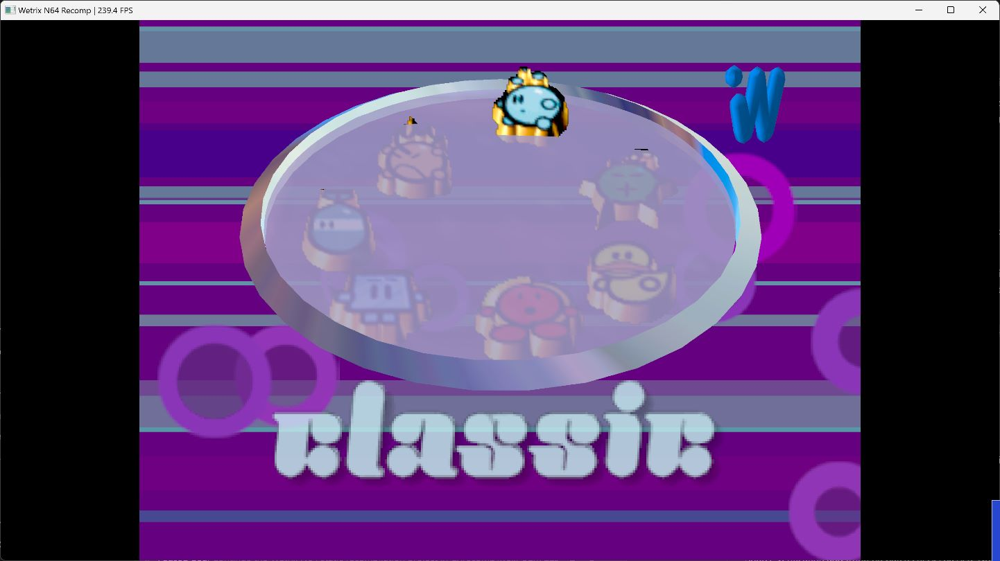
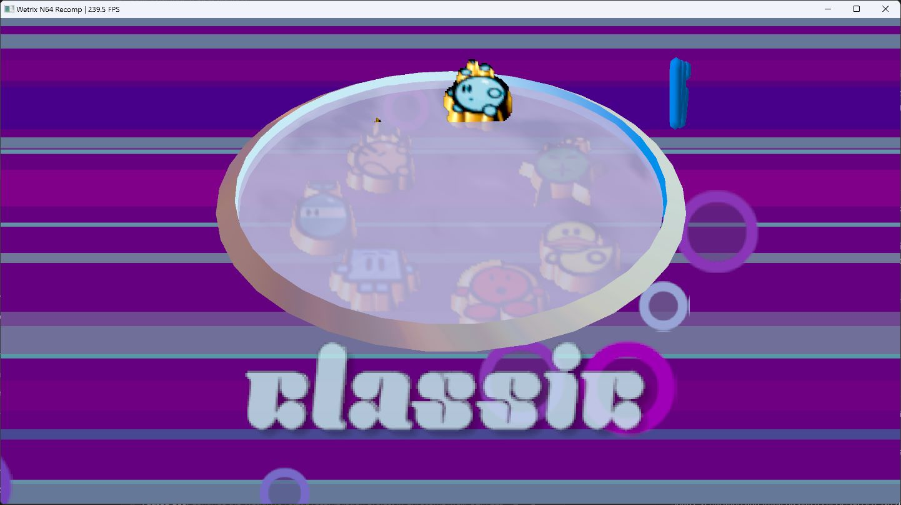
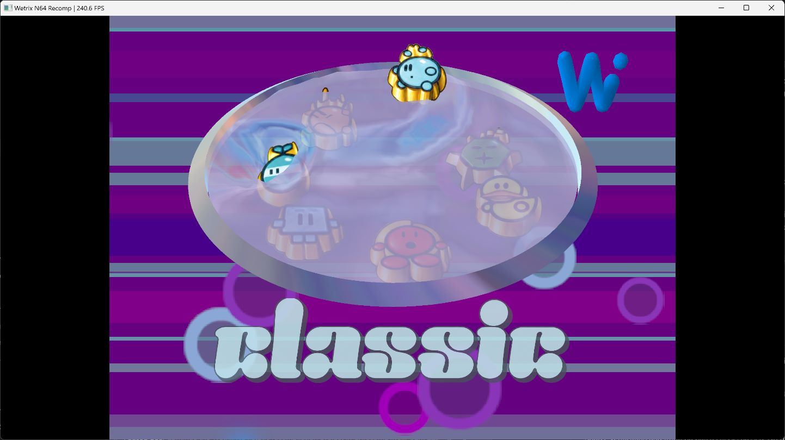
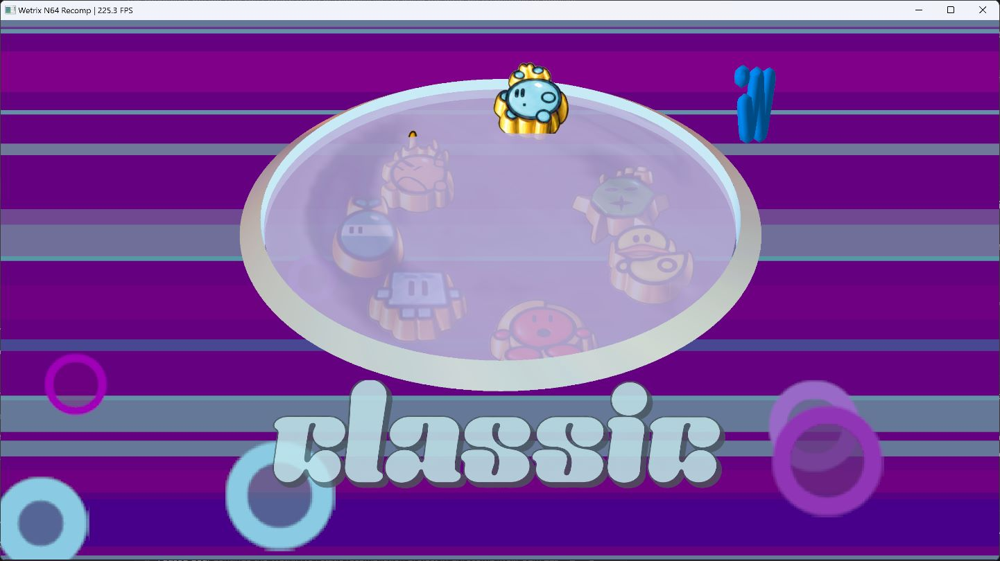
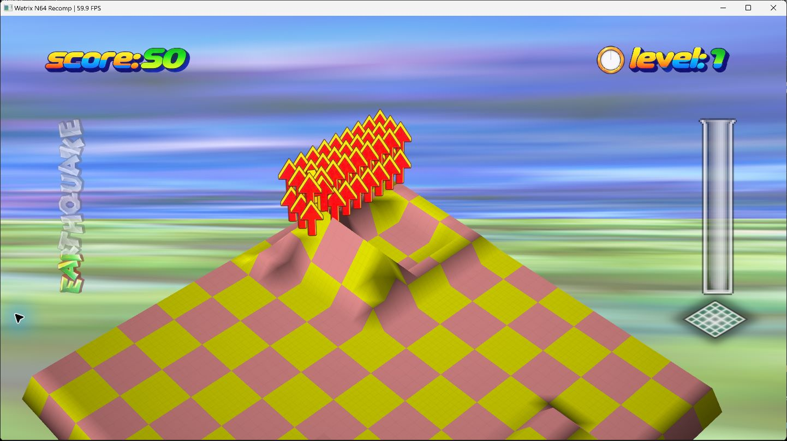
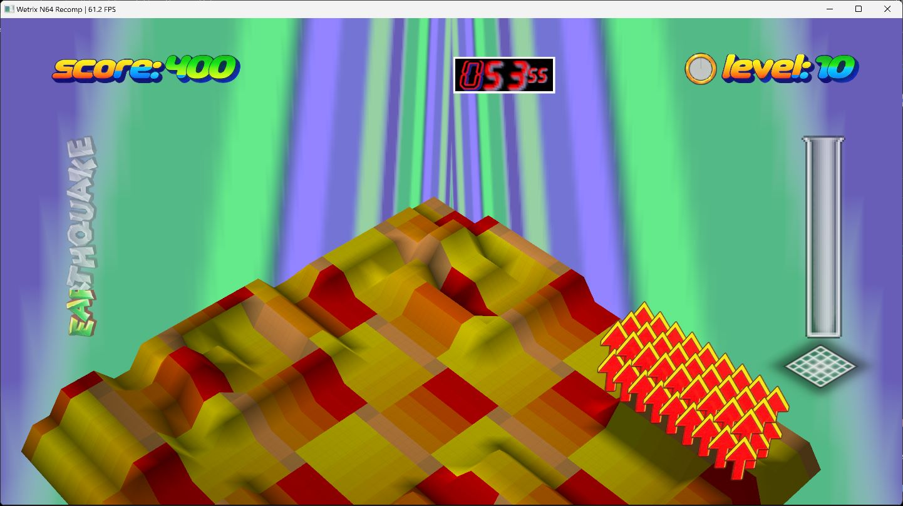
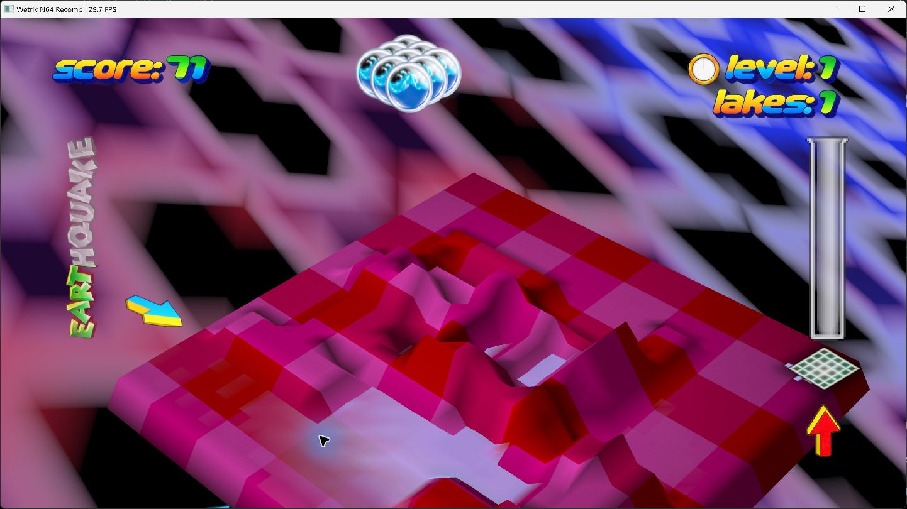
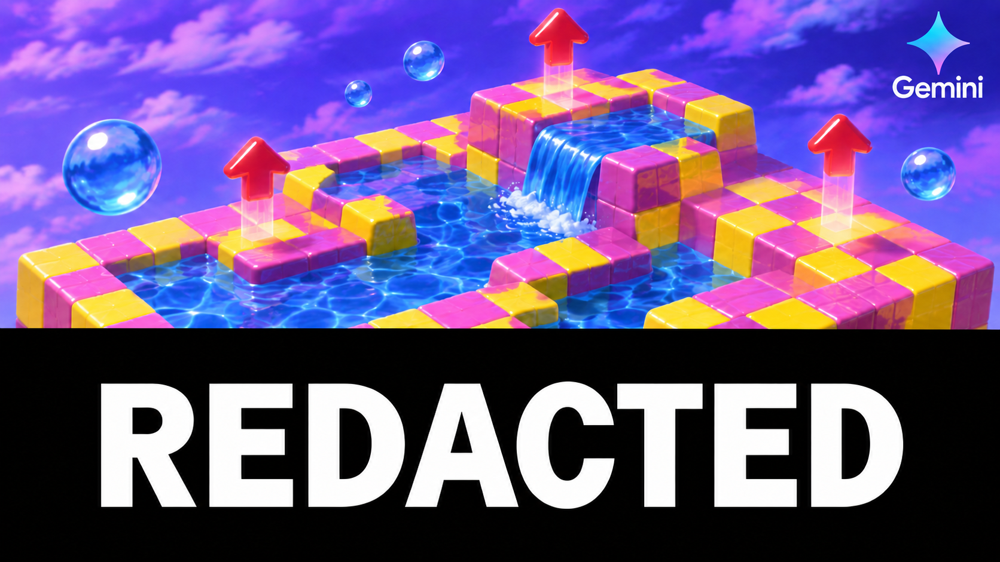

# Wetrix Recompiled 0.1.0

A native PC recompilation of Nintendo 64 Wetrix, built with N64: Recompiled, RT64 and RecompFrontend. Supply your own supported ROM. The application download includes neither a ROM nor the optional HD game-art pack.

This is an early release. Windows has received local builds and human playtesting. Successful compilation does not establish that every game mode, controller or platform works correctly.

## Screenshots

Actual Windows captures of the Classic title menu. The game animates between captures; these are not identical frames. [Capture details](docs/screenshots/CAPTURE-NOTES.txt).

| | Original 4:3 | Expand widescreen |
| --- | --- | --- |
| Original artwork |  |  |
| Optional HD artwork |  |  |

### Gameplay

Classic, Challenge and Practice, with HD Textures and Expand enabled. Each board was started through its native menu callback and played through a batch of piece drops until water appeared, then frozen after one second of flow, with the spill container kept empty. Captured in Original FPS mode; the published game is unchanged.

| Classic | Challenge | Practice |
| --- | --- | --- |
| [](docs/screenshots/classic-hd-expand.png) | [](docs/screenshots/challenge-hd-expand.png) | [](docs/screenshots/practice-hd-expand.png) |



*How did that one get in here? Pay no attention.*

## Getting started

Download the application for your platform from [Releases](https://github.com/scottjco/Wetrix_Recomp/releases/tag/v0.1.0). The optional HD texture pack is a separate download there. macOS builds require macOS 15 or newer; Linux builds use Ubuntu 24.04 as their baseline.

Extract the application into a writable folder. On Windows, open **WetrixRuntime.exe** directly; no command script or console window is needed. On Linux/macOS use the supplied launcher. If `Assets/data.z64` is missing, a file picker opens; select your supported ROM to verify and import it for future launches. Press **Escape** for settings and **Alt+Enter** to switch fullscreen/windowed.

The supported ROM is an 8,388,608-byte big-endian `.z64` image, internal title `WETRIX`, country E, revision 0, with SHA-256:

```text

790f36a3ddd64e4dcd08c479b0b66f9080d0191473e92fa895f53d15706167bb

```

Other regions, revisions and byte-swapped images are not interchangeable. ROM data remains local.

Defaults are **Hybrid**, **Display** frame-rate target, **Windowed** on desktops (**Fullscreen** on Steam Deck), and **Automatic** monitor selection. Automatic chooses the display containing the mouse pointer at launch. Use Controls to assign player devices and bindings. Fresh profiles use the controller layout selected during project playtesting, without tying it to any device identity.

Preferences live under `config/user/`; the controller pak is `saves/controller1.mpk`. Preserve your pak when updating. Release archives should contain no personal saves or configuration.

## Features

- Native CPU/audio microcode recompilation, RT64 graphics, game audio, keyboard and controller input.

- Hybrid combines responsive 60 Hz controls/piece motion with original fixed water/scoring timing and interpolated rendering.

- Interpolate keeps 30 Hz gameplay with smoother rendering; Original presents at 30 FPS. Targets include Display, 30, 60, 144, 240 and Unlimited, subject to hardware and display limits.

- Aspect-ratio options, expanded backgrounds and HUD placement, with foreground proportions retained where appropriate.

- Fine analog movement, separate rotation actions, remappable controls, two-player device assignment and live controller presence handling.

- Persistent controller-pak support, startup monitor selection, live FPS display and startup copyright-sequence skipping.

- Targeted corrections for water rendering performance, graphics commands, HUD placement, multiplayer music and rainbow visual timing.

## Optional HD pack

Install the separate pack's `Textures/hd-sprites/` folder beside the application. **HD Textures** defaults to on when a valid pack is installed and can be disabled in settings. Without a pack, its setting is hidden and the original art comes from your ROM.

The pack redraws many bitmap fonts, digits, menus, HUD meters/icons, clocks, earthquake indicators, carousel titles and animated sprites, plus the idle logo and studio subtitle. Native placement and frame layouts are retained. Native 3D logos remain geometry. Not every texture, language bank or scene is remastered.

Game-related redraws are outside the application code's GPL grant. Their separate rights notice and AI disclosure must accompany the pack. The application's settings fonts and generic control icons are separate interface assets.

## Limits and reporting bugs

Broader testing is still needed for long sessions, every lesson/game mode, save-menu path and multiplayer combination. High frame rates and widescreen can expose scene-specific problems. English HD artwork has broader coverage than other languages.

Windows is the locally exercised platform. See [platform build notes](docs/PLATFORM-BUILDS.md) for actual artifact status; equivalent Linux/macOS gameplay testing is not claimed. For reports, include the scene/mode, FPS Mode/target, aspect ratio, HD-pack setting, controller setup and a screenshot or recording. Do not attach ROMs or personal pak contents.

## Building

Initialize dependencies with `git submodule update --init --recursive`. The checkout needs CMake, Python 3.11+ and a C/C++ toolchain. The local Visual Studio preset uses `cmake --preset windows`, then `cmake --build build/windows --config Release --target WetrixRuntime`.

Regenerating game functions requires your supported ROM locally. Release/CI snapshots, where supplied, are translated source and headers, not ROM/data blobs; their presence does not grant rights to the original game code. Keep pinned dependencies and local patches together. Consult the platform notes for the release workflow and exact toolchains.

## Credits and licensing

Wetrix and its original code, art, music and trademarks belong to their respective rights holders. This independent fan project is not an official release or endorsement.

Thanks to Wiseguy, Dario and the contributors to [N64: Recompiled](https://github.com/N64Recomp/N64Recomp), [N64ModernRuntime](https://github.com/N64Recomp/N64ModernRuntime), [RT64](https://github.com/rt64/rt64), and [RecompFrontend](https://github.com/N64Recomp/RecompFrontend). Silicon Valley Recompiled provided a structural/interface reference; its game-specific hooks are not Wetrix hooks.

Project-authored integration code is **GPL-3.0-or-later**; see [LICENSE](LICENSE). This excludes translated original-game code and original/derived game assets. Dependencies retain their own terms. [THIRD_PARTY_NOTICES.md](THIRD_PARTY_NOTICES.md) and `release-notices/` preserve upstream texts, attribution and the frontend license history, project-authored icon attribution and font notices.

Settings fonts include Inter, Noto Emoji and PromptFont. PromptFont is by Yukari "Shinmera" Hafner, based on Xolonium by Severin Meyer. Their SIL Open Font License notices accompany the assets.

## AI assistance disclosure

AI was used extensively. OpenAI Codex assisted with code, debugging, reverse-engineering analysis, asset inventory and documentation. The optional HD pack includes AI-generated and AI-edited redraws followed by extraction, alignment and alpha cleanup.

Claude would probably file these water bugs under “watergate” and call the folder a feature. (Yes, that name is intentional.)

The human project owner directed the work, reviewed visuals and playtested changes. That does not make the implementation wholly human-authored or guarantee that every AI-assisted change is correct. Credit for the game and the foundations enabling this project stays with their original creators and contributors.
